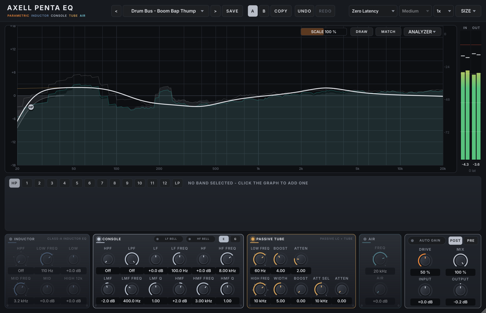
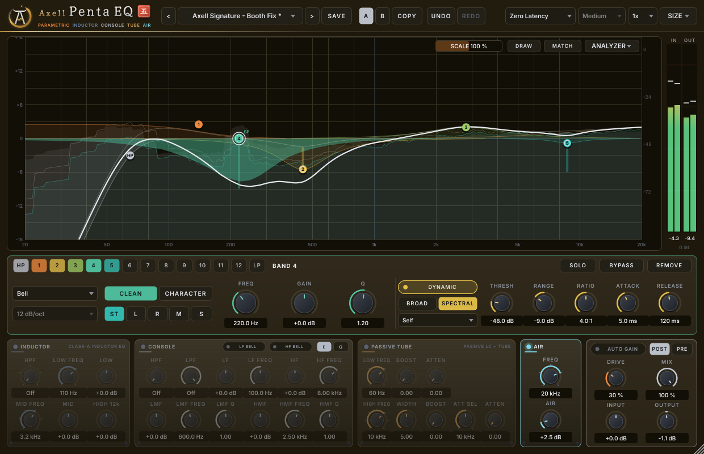
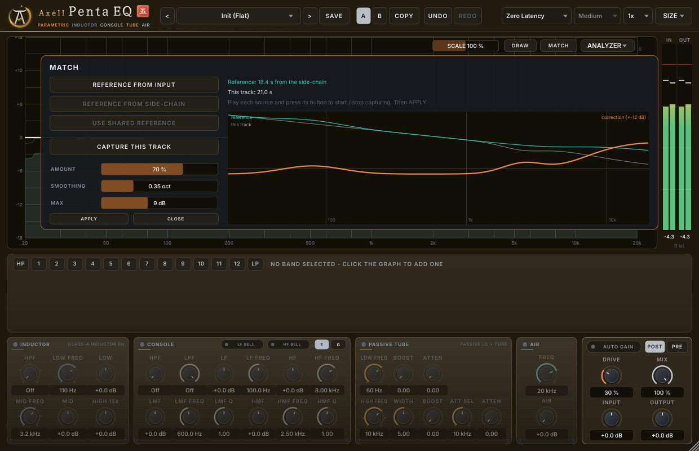
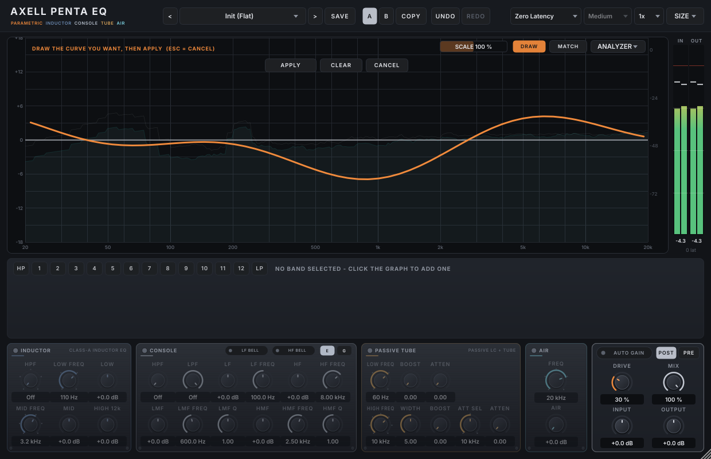
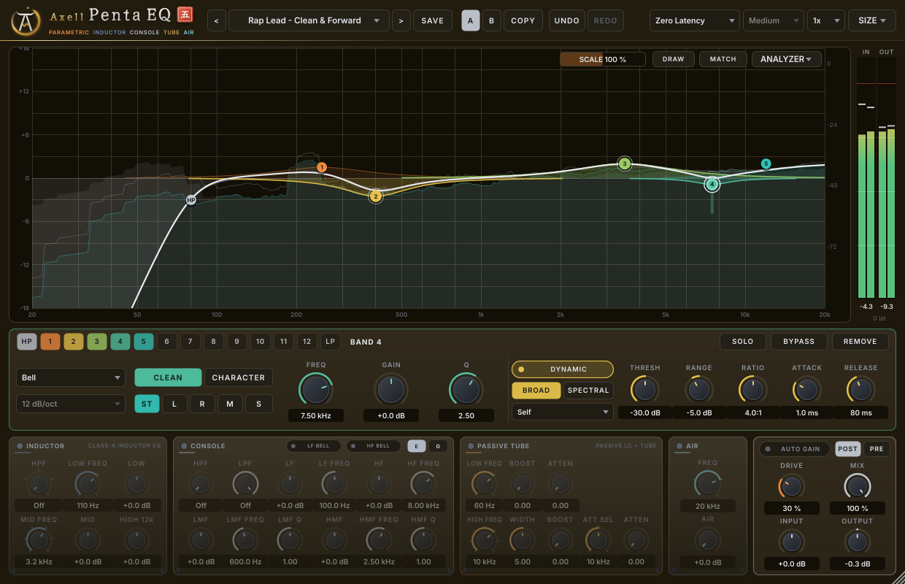
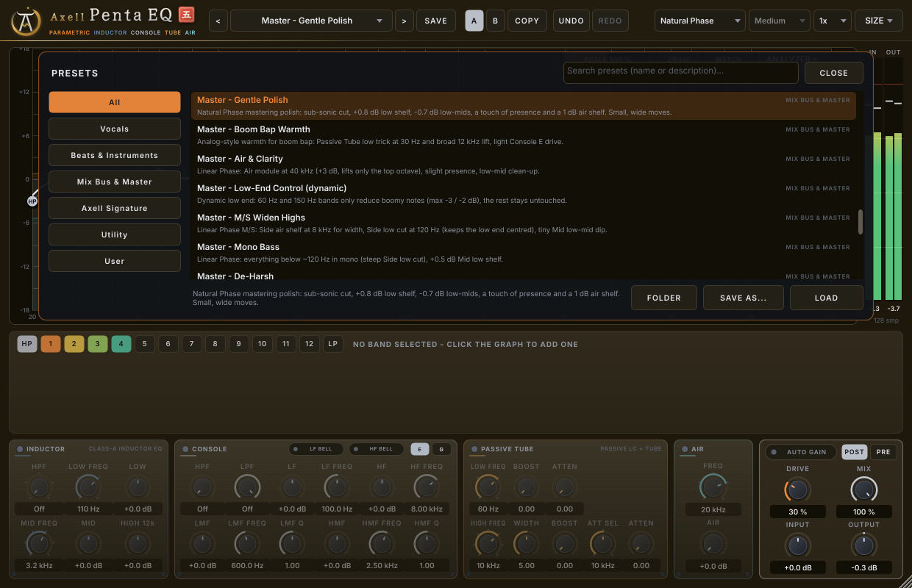
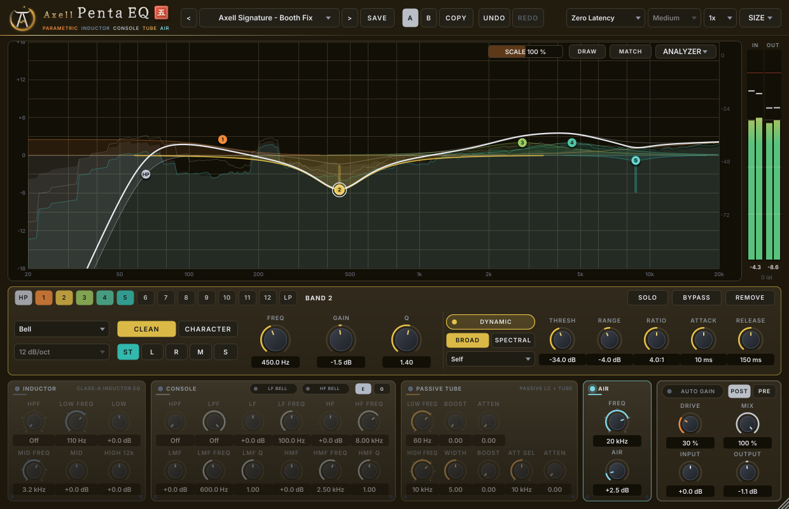

# Axell Penta EQ

An all-round equalizer VST3 for Linux by **Axell Yobag**: a surgical, analog-matched parametric EQ with dynamic and
spectral bands, Mid/Side, curve drawing and reference matching, plus a rack of four character modules - **Inductor**, **Console E/G**, **Passive Tube**
and **Air**. Built for rap and boom bap vocals, beats, 808s, the mix bus and the master. Companion to
[Duo Vocal Comp](https://github.com/zmardanian/duo-vocal-comp).



## Features

**Parametric core**
- 12 bands + dedicated high-pass and low-pass. Types: bell, low/high shelf, low/high cut (6–96 dB/oct with
  resonance), notch, band-pass, tilt.
- **Clean** mode: curves match the analog prototypes within ±0.1 dB up to 20 kHz - no "cramping" of high bells and
  shelves near the top of the spectrum, for every band type, gain, Q and frequency at 44.1–192 kHz, without
  exceptions (measured independently; see *Accuracy*).
- **Character** mode per band: proportional Q (wider at small gains, narrower at big ones), cuts tighter than
  boosts, and boosts that saturate gently with **Drive**.
- **Dynamic** per band: threshold, range (cut *or* boost when loud), ratio, attack, release. The detector can listen
  to the band's own region, to **another band's region** (cut 3 kHz when 9 kHz gets loud) or to the **external
  side-chain** (duck the 808's fundamental with the kick). De-essing, harshness, mud and boom control.
- **Spectral dynamics** per band: instead of moving as a whole, every frequency inside the band reacts on its own -
  only what is too loud gets cut (a resonance, a whistle, a harsh partial, a sharp sibilant), the rest of the band
  stays untouched. Zero added latency; the graph shows the live per-frequency gain.
- Per band placement: **Stereo / Left / Right / Mid / Side**.
- **Solo** a band's region to find problem frequencies.

**Character rack** (each switchable, before or after the parametric EQ)
- **Inductor** - class-A inductor channel EQ: 18 dB/oct HPF (50/80/160/300 Hz), resonant low shelf
  (35/60/110/220 Hz), musical mid (360 Hz–7.2 kHz), very gentle 12 kHz shelf, transformer saturation that grabs
  the lows first.
- **Console E/G** - four-band console channel EQ with HPF/LPF and bell switches. **E**: constant bandwidth, punchy;
  **G**: proportional Q and shelves with a little overshoot. Console clipping with Drive.
- **Passive Tube** - passive LC program EQ with tube makeup. Boost **and** attenuate the same low frequency for the
  classic trick: weight at the bottom and a dip just above that clears the mud. Broad high boost with bandwidth,
  separate high attenuation shelf, push-pull tube colour.
- **Air** - an ultra-wide, boost-only high shelf (2.5–40 kHz) that opens the top without extra sibilance.

**Global**
- **Phase modes**: *Zero Latency* (analog magnitude, no delay - for tracking), *Natural Phase* (analog magnitude
  **and** phase, 2.7 ms), *Linear Phase* (no phase shift; Low / Medium / High resolution). Latency is always reported
  to the host.
- Oversampling 1x / 2x / 4x for the drive stages, global **Drive**, **Input**/**Output** gain, **Mix**, static
  loudness-matched **Auto Gain** (never pumps).
- Spectrum analyzer: input (pre), output (post) and side-chain spectra, 1/6-octave smoothing, 4.5 dB/oct tilt,
  peak hold, adjustable speed and EQ scale.
- **Workflow**: select several bands and move them together, keyboard editing, copy/paste (also between
  instances), invert, note readout and snapping, a band on a spectrum peak with one click, **Draw** a curve and let
  the EQ build it, **Match** your track to a reference, **Gain Scale** (0–200 %).
- **42 factory presets** (all loudness-matched), user presets with descriptions, preset browser with categories and
  search, **A/B** compare (saved with the session), **undo/redo**.
- Resizable vector GUI (75–200 %), sharp on HiDPI, tooltips on every control.

| | |
|---|---|
|  |  |
|  |  |
|  |  |

## Using it

### The graph
| Action | Result |
|---|---|
| Click on empty space | add a bell band there (gain from the click height) |
| Drag on empty space | select the bands inside the frame (Ctrl/Shift: add to the selection) |
| Ctrl/Cmd + click a dot | add / remove it from the selection |
| Drag a dot | frequency (left/right) and gain (up/down); a selection moves together; cuts, notch and band-pass: up/down = resonance/Q |
| Shift + drag / Ctrl + drag | fine adjustment / Q |
| Mouse wheel on a dot | Q (Shift = fine), for the whole selection |
| Double-click a dot | gain back to 0 dB |
| Alt + click a dot | remove the band (or the selection) |
| Alt + click empty space | a new narrow band on the nearest spectrum peak (hold Alt to see it first) |
| Right-click a dot / empty space | band menu (type, slope, placement, mode, dynamic, spectral, invert, copy/paste, remove) / graph menu |

| Key | Action |
|---|---|
| ← → / ↑ ↓ | frequency ±1 semitone / gain ±0.5 dB (Shift: 1/96 octave / 0.1 dB; cuts: ↑ ↓ = Q) |
| Del, Backspace | remove the selected bands |
| Ctrl+A, Esc, Tab / Shift+Tab | select all, select none, next / previous band |
| I, B | invert the gains, bypass |
| Ctrl+C, Ctrl+V | copy a band, paste it onto the selection or into a free band (works between instances) |
| Ctrl+Z, Ctrl+Shift+Z / Ctrl+Y | undo, redo |

The readout shows the note of the frequency (e.g. *A4 +20ct*); **Snap frequency to notes** (analyzer or graph
menu) makes drags and nudges land on semitones. **SCALE** in the graph's top bar scales the gain of every band
(0–200 %, double-click = 100 %).

**DRAW**: paint the curve you want across the graph (several strokes are fine; unpainted parts count as flat), then
**APPLY** - the EQ fits up to 12 bands to it (one undo step). **MATCH**: play a reference (a mix you like) through the
side-chain, through this instance, or through another instance of the EQ in the session and capture it; play your
track and capture it; set amount, smoothing and the largest correction and press **APPLY**. The level difference
is removed - it matches tone, not loudness.

Dynamic bands show a bar from their static gain to the end of their range; the white curve moves live, the faint
curve is the static setting. The **ANALYZER** menu in the graph's corner sets pre/post/side-chain display, peak hold,
tilt, speed and the EQ scale (±6/12/18/30 dB).

### Band panel
Band chips **HP 1 … 12 LP** select a band (grey chips are free: clicking one switches it on as a flat bell).
**SOLO** (hold) plays only the band's region, **BYPASS** keeps the band but disables it, **REMOVE** deletes it.
The right half holds the **DYNAMIC** section: threshold, range, ratio, attack, release, the detector source
(*Self*, *Band n* or *External*) and **BROAD / SPECTRAL**. Spectral thresholds are per frequency: loud music reads
about −45 to −25 dBFS per frequency, so around −30 dB the band catches ringing peaks and lets the rest pass.

### Header
Preset menu (opens the browser), previous/next, **SAVE**, **A / B / COPY**, **UNDO / REDO** (Ctrl+Z,
Ctrl+Shift+Z or Ctrl+Y), phase mode, linear-phase resolution, oversampling, interface size.

### Side-chain in REAPER
The plugin has a stereo side-chain input (plug-in pins 3/4). On the track with Axell Penta EQ, set the track to
4 channels; on the trigger track (e.g. the kick) add a send to that track, *Audio: 1/2 → 3/4*. Then set a dynamic
band's detector to **External**. The presets *Bass/Kick Carve* and *Sample Chop - Room for Vocals* use this.

### Latency by mode (48 kHz)
| Mode | Latency |
|---|---|
| Zero Latency, OS 1x | 0 |
| Natural Phase | 128 samples (2.7 ms) |
| Linear Phase Low / Medium / High | 2176 / 4352 / 17408 samples (45 / 91 / 363 ms) |
| Oversampling 2x / 4x | + 71 / 79 samples (+ 25 / 33 at 88.2–96 kHz) |

Linear Phase resolves narrow low-frequency moves better at higher resolution (Medium: from about 40 × Q Hz and
100 Hz up; High: from about 10 × Q Hz).

## Factory presets

| Category | Presets |
|---|---|
| **Vocals** (14) | Rap Lead - Clean & Forward · Boom Bap Lead - Warm Grit · Dark & Gritty Lead · Doubles - Tuck Behind · Ad-libs - Hype Cut · Backing Stack - Wide & Soft · Telephone / Lo-fi · De-ess + Air · Podcast / Spoken Word · Chorus / Hook Lift · Harsh Mic Tamer · Room Box Removal · Rap Lead - Passive Tube Polish · Vocal - Spectral Harshness Tamer |
| **Beats & Instruments** (13) | Kick - Punch & Knock · Snare - Crack & Body · Hats - Smooth Sizzle · 808 - Clean Sub + Bite · Bass - Defined Low End · Dusty Sampler (12-bit era) · Vinyl Loop Cleanup · Keys / Rhodes - Warm Bell · Guitar - Clean Up & Presence · Drum Bus - Boom Bap Thump · Beat Bus - Glue Polish · Bass/Kick Carve (side-chain) · Sample Chop - Room for Vocals |
| **Mix Bus & Master** (10) | Master - Gentle Polish · Master - Boom Bap Warmth · Master - Air & Clarity · Master - Low-End Control (dynamic) · Master - M/S Widen Highs · Master - Mono Bass · Master - De-Harsh · Master - Loudness Prep · Mix Bus - Console Glue · Mix Bus - Spectral Resonance Control |
| **Axell Signature** (4) | LCT 440 Pure · SM7B · Booth Fix · Tracking (Light) - tuned to a measured voice (thin 80–160 Hz chest, booth box at 350–600 Hz, presence dip at 2.5–5 kHz, sibilance at 8–10 kHz, dark tilt) |
| **Utility** | Init (Flat) |

Every preset has a description in the browser. All of them are loudness-matched to bypass (within ±0.05 LU on pink
noise), so switching compares tone, not level. The measured frequency response of every preset is in
[docs/preset-curves](docs/preset-curves/README.md), and where each move comes from is documented in
[docs/research/preset-sources.md](docs/research/preset-sources.md). Dynamic thresholds assume a normal tracked
level (vocal peaks around −6 dBFS); adjust THRESH if yours is very different.

User presets are saved to `~/.local/share/AxellPentaEQ/Presets` (with your own description).

## Requirements

- x86_64 Linux with glibc 2.39 or newer (for example Bazzite, Fedora 40+, Ubuntu 24.04+)
- Any VST3 host. Tested in REAPER.
- The system libraries `libfreetype` and `libfontconfig` (present on every desktop distribution)

## Install

1. Download `AxellPentaEQ-2.0.1-linux-x86_64.tar.gz` from the
   [latest release](https://github.com/zmardanian/axell-penta-eq/releases/latest).
2. Extract it and run the installer:

   ```bash
   tar xzf AxellPentaEQ-2.0.1-linux-x86_64.tar.gz
   cd AxellPentaEQ-2.0.1-linux-x86_64
   ./install.sh
   ```

3. Restart your DAW (REAPER scans new plugins at startup), then search for "Penta" in the FX browser.

`install.sh` copies the plugin to `~/.vst3`, only ever replaces an older copy of Axell Penta EQ, and checks that
every system library the plugin needs is present. Verify the download (optional) with `sha256sum -c SHA256SUMS.txt`.

**REAPER can't find it?** Options → Preferences → Plug-ins → VST: make sure the VST path contains `~/.vst3`
(on Bazzite and other Fedora atomic systems write the full path `/var/home/<your-user>/.vst3`), then click
*Re-scan* (or *Clear cache/re-scan*).

### Uninstall
Run `./uninstall.sh` from the extracted release folder, or `rm -rf ~/.vst3/"Axell Penta EQ.vst3"`.
Your presets stay in `~/.local/share/AxellPentaEQ/Presets`.

## Build from source

See [docs/DEVELOPMENT.md](docs/DEVELOPMENT.md). In short (Bazzite/Fedora atomic, inside a distrobox):

```bash
bash scripts/setup-toolbox.sh     # Ubuntu 24.04 box with the JUCE dependencies, nothing layered on the host
bash scripts/build.sh             # Release build
bash scripts/test.sh              # DSP + plugin test suites
bash scripts/install.sh           # copy to ~/.vst3
```

## Quality

- **DSP suite** (`tests/DspTests.cpp`, JUCE-free): 743 checks at 44.1/48/88.2/96/192 kHz, mono and stereo -
  Clean magnitude vs analog on ~600 filter settings per mode (worst error: Zero Latency 0.003 dB, Natural 0.05 dB,
  Linear 0.10 dB), plus textbook references independent of the engine's own model (exact Butterworth curves at
  every slope, RBJ resonant shelves over the whole Q range without oversampling, every band type centred at
  12–30 kHz, steep narrow band-pass in Natural Phase), bit-exact flat nulls, latency = impulse delay in every mode,
  bit-identical output for any block size (with a spectral band), random extreme automation fuzzing (no NaN/Inf),
  click tests for every switch including phase-mode changes, near-Nyquist sweeps and spectral on/off during
  playback, dynamic and spectral bands (selectivity, upward mode, side-chain, Mid/Side), L/R/M/S isolation
  (≤ −120 dBFS leakage), character-module curves and harmonics, presets (loudness within ±0.1 LU), and zero heap
  allocations in the audio path. Both suites also pass under AddressSanitizer + UBSan + LeakSanitizer.
  Report: [tests/report.md](tests/report.md).
- **Plugin suite** (`tests/PluginTests.cpp`): 80 checks - parameters (2.0 additions appended, 1.0 sessions open
  unchanged), bit-identical session restore (A/B included), presets, user presets, A/B, undo/redo, latency in every
  mode and the latency handshake with the host, buses, side-chain, latency-aligned bypass, editor lifecycle, graph
  mouse and keyboard interaction (selection, frame, group drag, nudge, invert, copy/paste, note snapping, spectrum
  peak grab), Draw and Match end to end, Gain Scale on the audio, type changes resetting a neutral Q, tooltips on
  every control.
- **Independent audit** ([tests/independent](tests/independent/README.md)): a separate VST3 host loads the built
  bundle and sets parameters as a host does. Its output is compared with analog curves computed by scipy, sharing
  no code with the plugin: 1526 random settings of every band type at six sample rates (including Q up to 24 and
  band frequencies up to 30 kHz at 44.1/48 kHz, Zero Latency and Natural Phase) - all within spec, **none exempt** -
  plus 174 processing checks: latency (also live, against the host's current compensation), linearity,
  block-size invariance, M/S, Mix, Linear Phase, clicks, dynamics, spectral dynamics, Gain Scale and side-chain.
  Report: [tests/independent/audit-report.txt](tests/independent/audit-report.txt). Every defect it ever found is
  listed in its README.
- **pluginval** strictness 10: SUCCESS (three seeds), including the **Steinberg VST3 validator** (47/47 tests).
- **REAPER**: loaded, automated by script, rendered offline - the render matches the analog curve within 0.01 dB.
- **CPU** (one stereo instance, 48 kHz / 128 samples, 8-core Zen 3 laptop): vocal chain 1.4 %, the same with two
  spectral bands 2.7 %, beat bus with Console + Passive Tube at 2x 2.9 %, mastering chain in Natural Phase 1.5 %, in
  Linear Phase 1.3 %; four fitted near-Nyquist bands (two dynamic, gain moving) 4.2 %; worst case (12 dynamic
  Character bands + all modules at 4x) 13 %.

### Accuracy

Clean mode follows the analog prototypes within **±0.1 dB** from 20 Hz to 20 kHz wherever the curve is above −24 dB.
Cuts stay within ±0.5 dB down to −48 dB. Natural Phase also follows the analog phase (within a few degrees). This
holds in Zero Latency and Natural Phase for **every band type, gain, Q and frequency** (up to the control's 30 kHz)
at **every sample rate, 44.1 kHz included, without oversampling** - no exceptions (since 2.0; the independent audit
checks it with nothing exempt).

Near Nyquist a plain 2nd-order digital section cannot follow an analog curve whose resonance or centre lies close to
or above Nyquist. Those sections - only those - are realised as a pair of biquads fitted to the analog curve across the
audio band, stable and minimum phase by construction; above 20 kHz the response may stay below the analog curve but
never rises more than 3 dB above it. Notch and band-pass act at their true centre, also above Nyquist (a 25 kHz notch
shapes the top of the band like the analog one). Every other band keeps the classic matched design, so typical
settings sound and cost exactly as before.

Linear Phase resolves low, narrow bands according to its resolution: Medium f ≥ max(100 Hz, 40·Q), High f ≥ 10·Q.

How the filter core works (matched biquads + a minimum-phase correction FIR that keeps Zero Latency truly zero
latency) is described in [docs/research/dsp-literature.md](docs/research/dsp-literature.md) and
[docs/ENGINEERING_SPEC.md](docs/ENGINEERING_SPEC.md).

## Licence

Axell Penta EQ is free software, licensed under the [GNU Affero General Public License v3](LICENSE), because it is
built with the [JUCE](https://juce.com) framework under JUCE's AGPLv3 option. Third-party components and their
licences are listed in [THIRD_PARTY_NOTICES.md](THIRD_PARTY_NOTICES.md).

The character modules are behavioural models built from published specifications, circuit descriptions and
measurements; no code, images or data from any commercial product are used, and the modules carry descriptive
names only. Microphone model names in the Signature presets only say which microphone a preset was tuned for. This
project is not affiliated with or endorsed by any equipment manufacturer. VST is a registered trademark of
Steinberg Media Technologies GmbH.
