# Preset frequency responses

Measured from the engine (impulse at -60 dBFS so dynamic bands sit at their static gain and drive adds no colour; 48 kHz; the preset's own phase mode). White = Mid (what a centred source hears), teal = Side (only drawn where it differs from Mid, i.e. presets with Mid/Side bands), dashed orange = analog model incl. output trim. Generated by `PentaCurvePlot`.

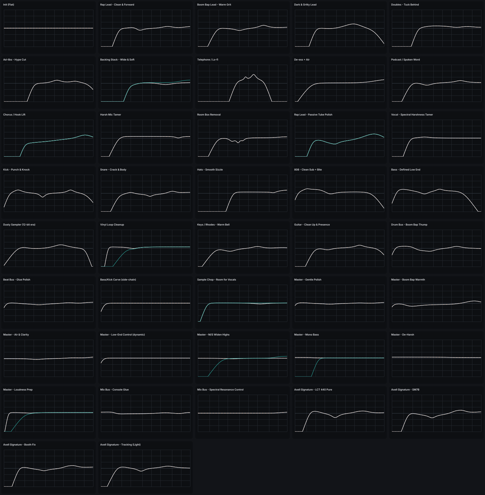

## Init (Flat)

*Utility* - Everything flat, all character modules off. A clean starting point.

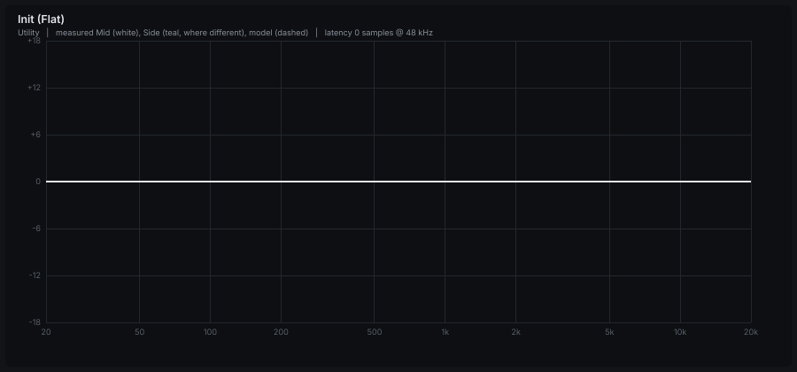

## Rap Lead - Clean & Forward

*Vocals* - Modern rap lead: low cut at 80 Hz, a little body at 250 Hz, box cut at 400 Hz, broad presence at 3.5 kHz, a dynamic de-esser at 7.5 kHz and a soft air shelf.

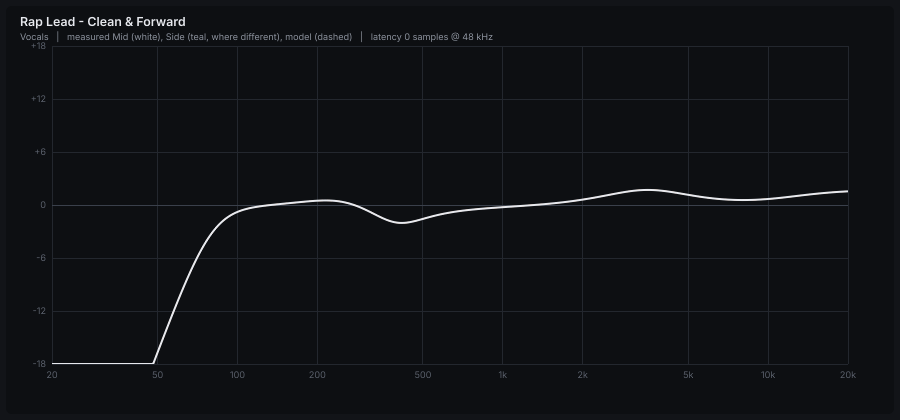

## Boom Bap Lead - Warm Grit

*Vocals* - Classic boom bap lead with the Inductor module pushing 3.2 kHz bite and 110 Hz weight; the parametric side cleans 500 Hz and de-esses dynamically. Drive adds transformer density.

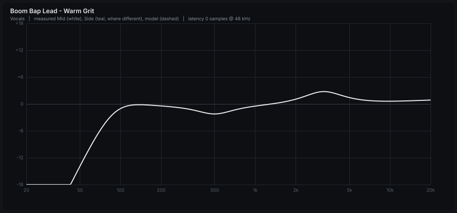

## Dark & Gritty Lead

*Vocals* - Darker, saturated lead for dusty beats: Character bell at 1.5 kHz, gentle top roll-off at 9 kHz, Console G mid push and heavy drive.

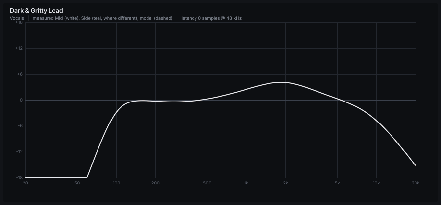

## Doubles - Tuck Behind

*Vocals* - For double tracks: higher low cut, less low-mid and presence than the lead, deeper de-essing and a softer top so the double supports instead of competing.

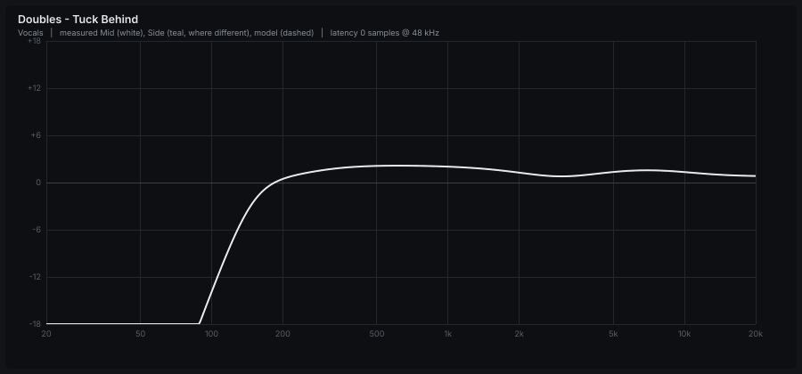

## Ad-libs - Hype Cut

*Vocals* - Ad-libs that cut through the beat: strong low cut, forward 1.2 kHz and 5 kHz, a little air and a 14 kHz low pass to keep them out of the cymbals.

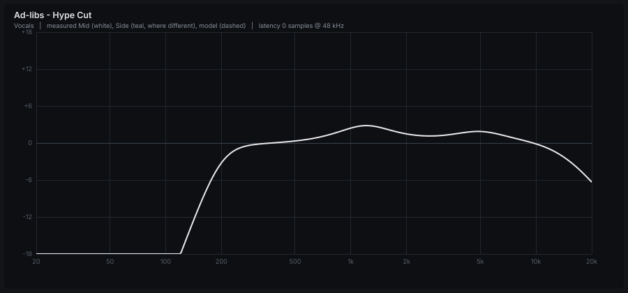

## Backing Stack - Wide & Soft

*Vocals* - Stereo backing-vocal bus: thinned lows, Mid dip at 3 kHz to make room for the lead, Side-only air shelf for width.

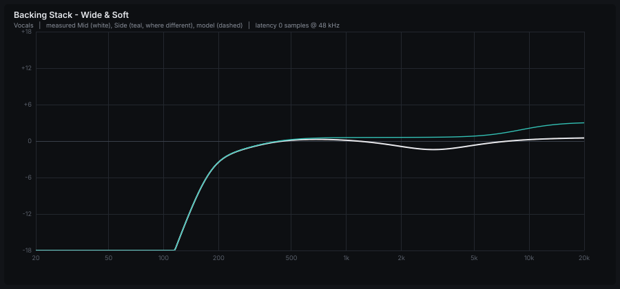

## Telephone / Lo-fi

*Vocals* - Band-limited phone/radio voice: 400 Hz - 3.4 kHz with two narrow resonances and console drive. Deliberately thinner and quieter in the lows (loudness not matched).

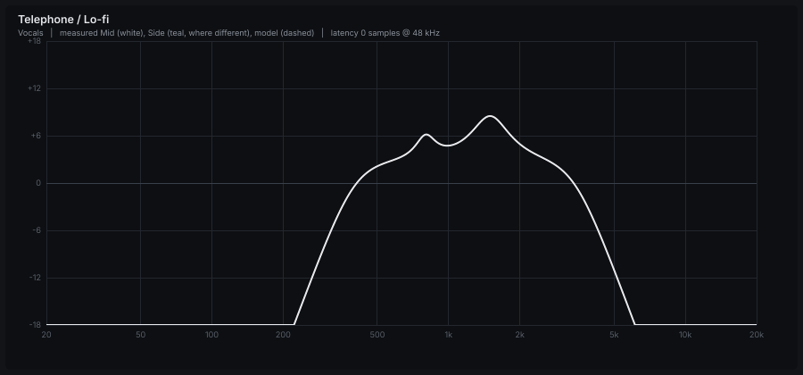

## De-ess + Air

*Vocals* - Two dynamic de-essing bands (6.5 kHz and 9 kHz) that only act on S and T sounds, plus the Air module at 20 kHz for open highs without extra sibilance.

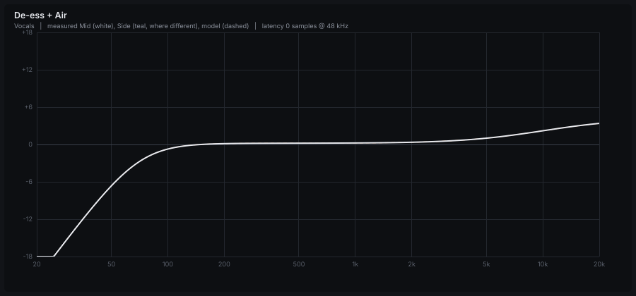

## Podcast / Spoken Word

*Vocals* - Clear speech: low cut at 90 Hz, warmth at 120 Hz, less 300 Hz mud, intelligibility at 4 kHz and a gentle dynamic de-esser.

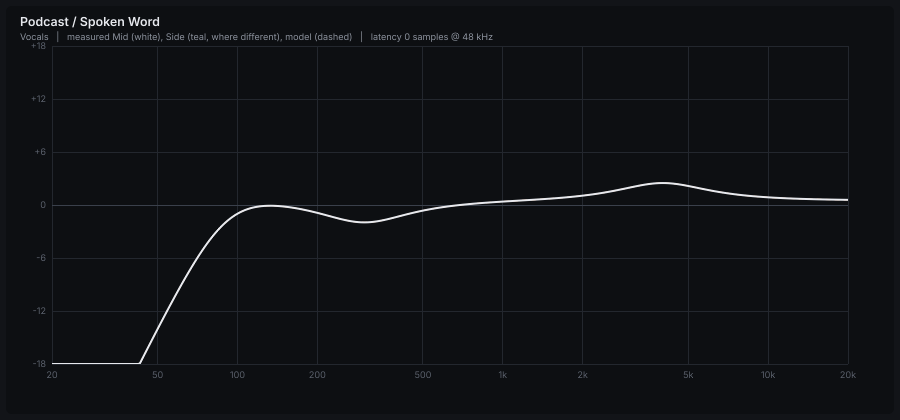

## Chorus / Hook Lift

*Vocals* - Makes a hook bigger and brighter than the verses: Character presence bell, high shelf and the Passive Tube high boost (10 kHz, broad).

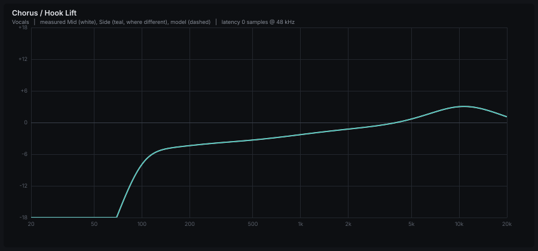

## Harsh Mic Tamer

*Vocals* - For bright or cheap condensers: dynamic bands at 3 kHz and 5.5 kHz only pull back when the voice gets harsh, a small static dip at 8 kHz.

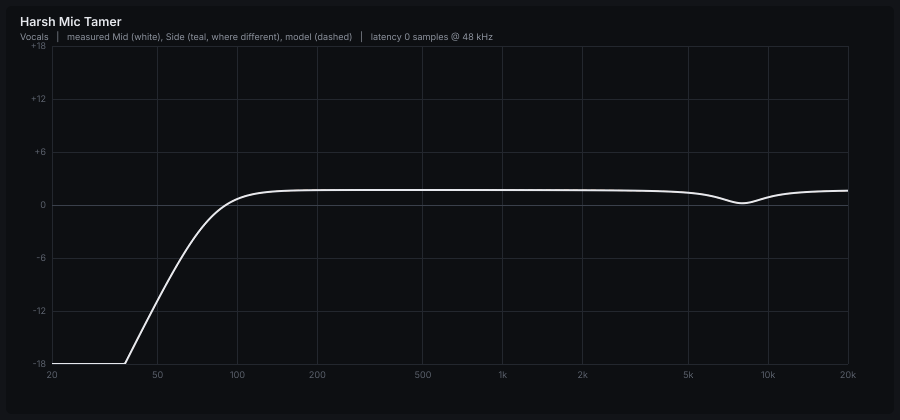

## Room Box Removal

*Vocals* - Small-room / closet booth fix: three narrow cuts at 280, 450 and 650 Hz where booth modes pile up, plus a little top to restore openness. EQ only reduces the steady colour, not the reverb tail.

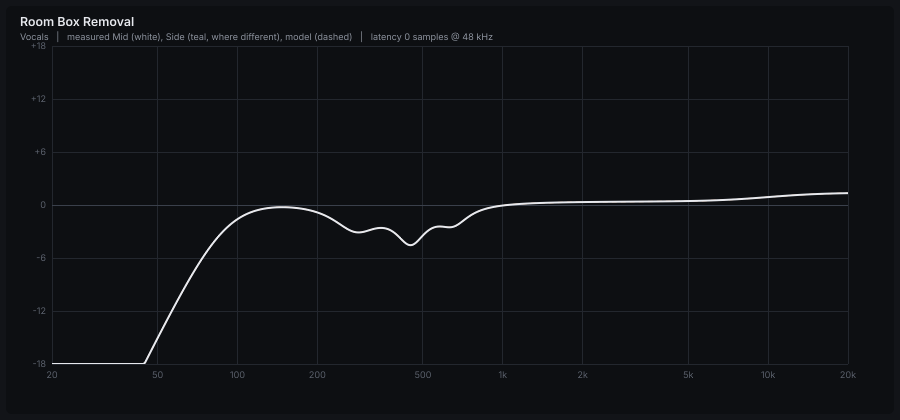

## Rap Lead - Passive Tube Polish

*Vocals* - Smooth, expensive-sounding lead: Passive Tube low end (100 Hz boost + a touch of atten), broad 10 kHz boost, 20 kHz soft roll; parametric box cut and de-esser.

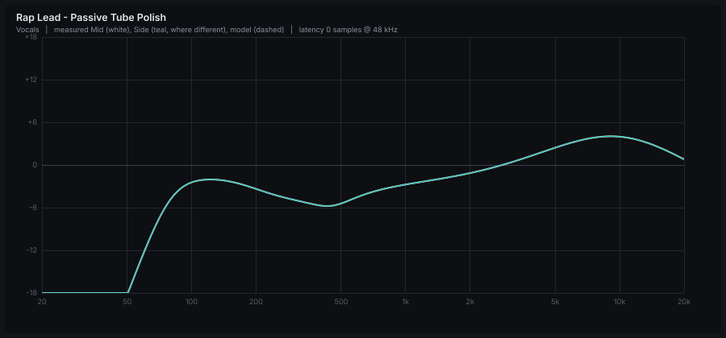

## Vocal - Spectral Harshness Tamer

*Vocals* - Spectral dynamics on a bright or harsh lead: only the frequencies that jump out between 2 and 5 kHz (and the sharpest sibilants above 6 kHz) are pulled back, each on its own - the rest of the presence stays. Zero latency, for tracking too.

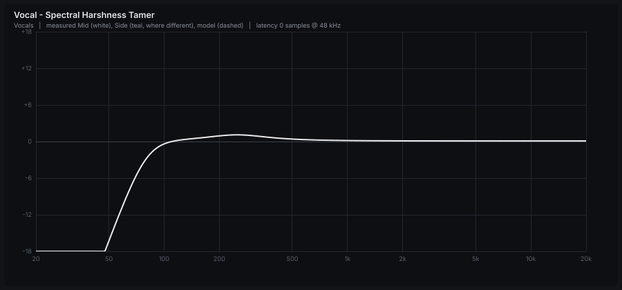

## Kick - Punch & Knock

*Beats & Instruments* - Kick weight at 60 Hz, box cut at 400 Hz, beater click at 3.5 kHz; sub-sonic and top clean-up.

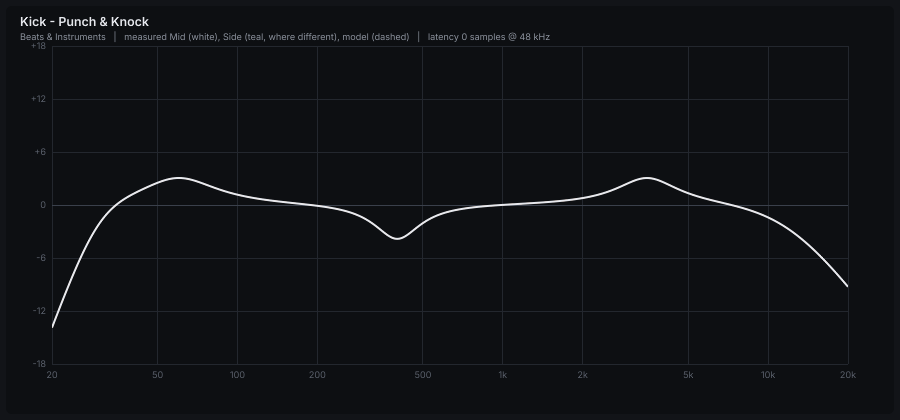

## Snare - Crack & Body

*Beats & Instruments* - Snare body at 200 Hz, less honk at 900 Hz, crack at 5 kHz and snap on top.

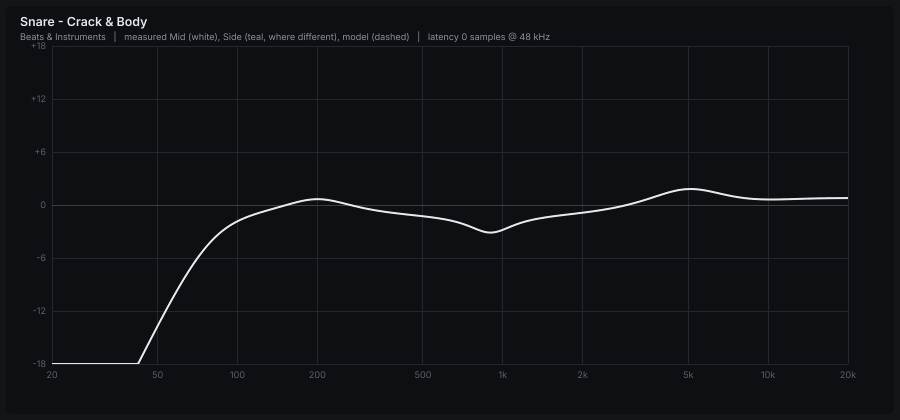

## Hats - Smooth Sizzle

*Beats & Instruments* - Hi-hats and cymbals: steep low cut at 300 Hz, dynamic 3 kHz harshness control, smooth sizzle shelf.

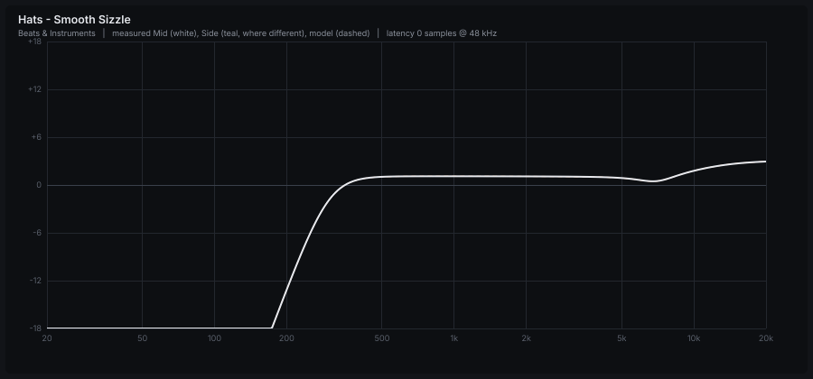

## 808 - Clean Sub + Bite

*Beats & Instruments* - 808 that translates to small speakers: sub-sonic cut, 50 Hz weight, saturated Character band at 120 Hz to bring out the harmonics, 300 Hz clean-up.

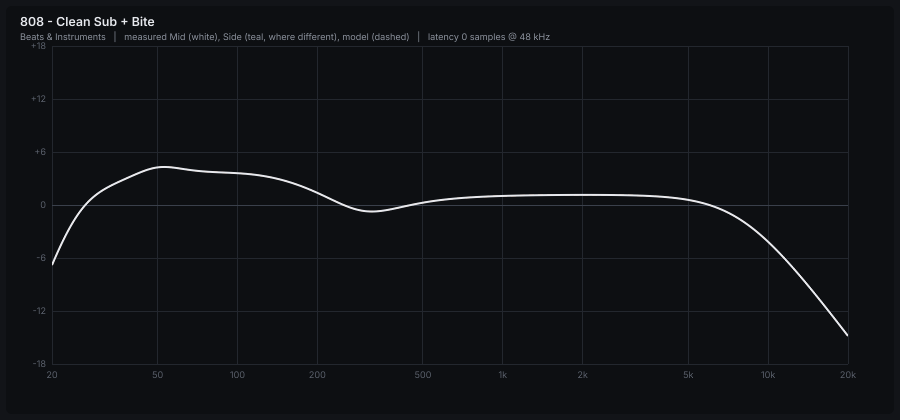

## Bass - Defined Low End

*Beats & Instruments* - Bass guitar or synth bass: 30 Hz cut, 80 Hz shelf, 250 Hz mud cut, 800 Hz growl for definition.

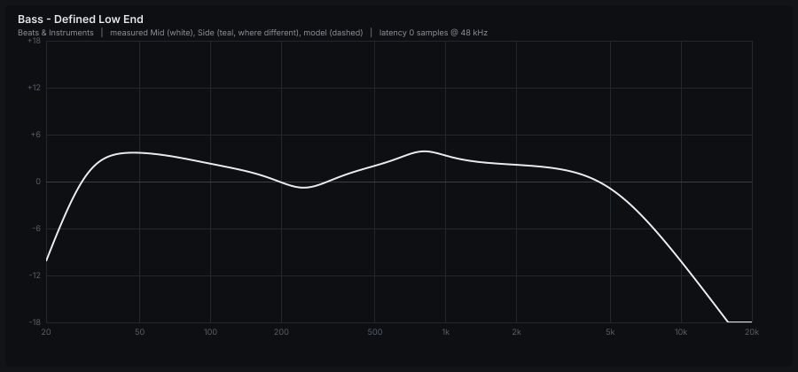

## Dusty Sampler (12-bit era)

*Beats & Instruments* - The rolled-off, gritty top of late-80s 12-bit samplers: 11 kHz low pass, saturated mids through the Inductor module and a Character bell. Use on drum loops and chops.

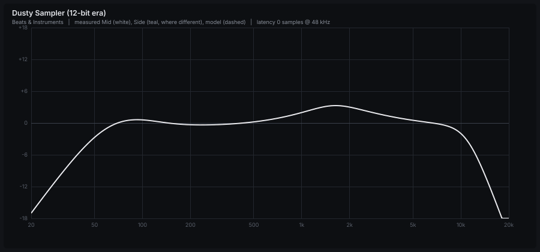

## Vinyl Loop Cleanup

*Beats & Instruments* - Sampled vinyl: steep rumble filter, mono low end (Side low cut at 150 Hz), dynamic control of the 9 kHz crackle zone, a little low-mid clean-up.

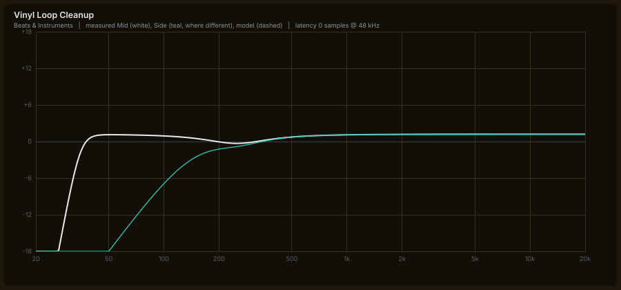

## Keys / Rhodes - Warm Bell

*Beats & Instruments* - Electric piano and keys: clean low end, less 250 Hz mud, tine/bell clarity at 2 kHz, Passive Tube low warmth.

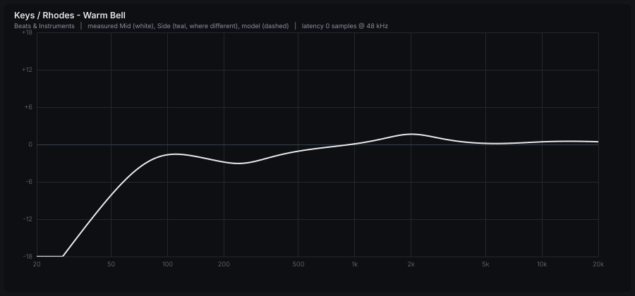

## Guitar - Clean Up & Presence

*Beats & Instruments* - Guitar or sampled guitar: 90 Hz cut, 250 Hz mud cut, presence at 3 kHz, smooth top roll-off.

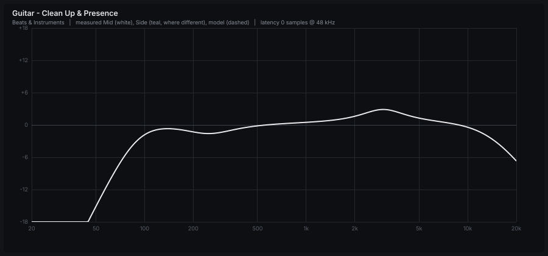

## Drum Bus - Boom Bap Thump

*Beats & Instruments* - Drum bus weight and knock: Passive Tube low-end trick at 60 Hz (bump + dip that clears mud), Console E mid cut and 3 kHz push with drive for punch.

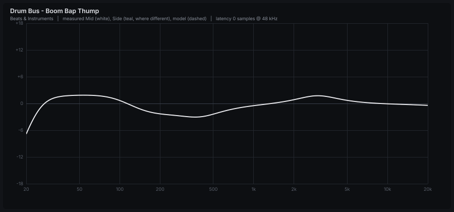

## Beat Bus - Glue Polish

*Beats & Instruments* - Whole-beat polish: subtle low shelf, low-mid clean-up, open presence and air, gentle Console G drive.

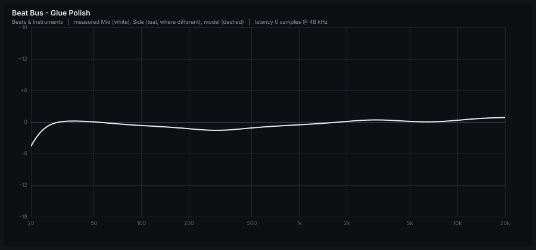

## Bass/Kick Carve (side-chain)

*Beats & Instruments* - Put on the 808 or bass and feed the KICK into the side-chain input (REAPER: channels 3/4). The 60 Hz band ducks by 6 dB and the 3.5 kHz band by 3 dB only while the kick hits.

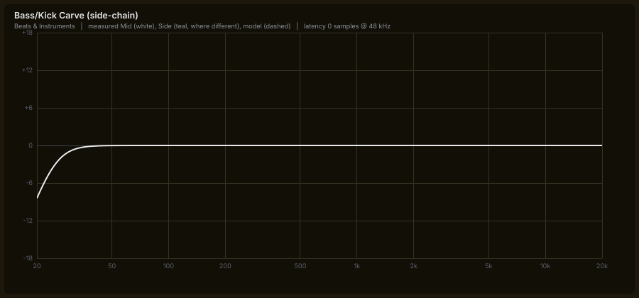

## Sample Chop - Room for Vocals

*Beats & Instruments* - Put on the beat or sample and feed the VOCAL into the side-chain: the Mid 2.5 kHz region ducks while the rapper talks, plus a static 40 Hz clean-up.

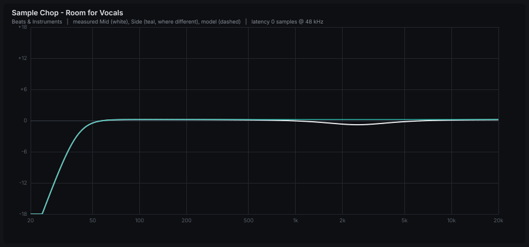

## Master - Gentle Polish

*Mix Bus & Master* - Natural Phase mastering polish: sub-sonic cut, +0.8 dB low shelf, -0.7 dB low-mids, a touch of presence and a 1 dB air shelf. Small, wide moves.

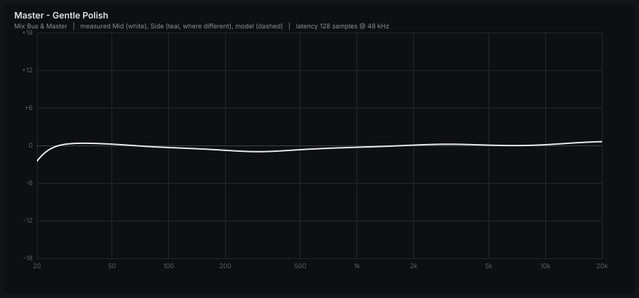

## Master - Boom Bap Warmth

*Mix Bus & Master* - Analog-style warmth for boom bap: Passive Tube low trick at 30 Hz and broad 12 kHz lift, light Console E drive.

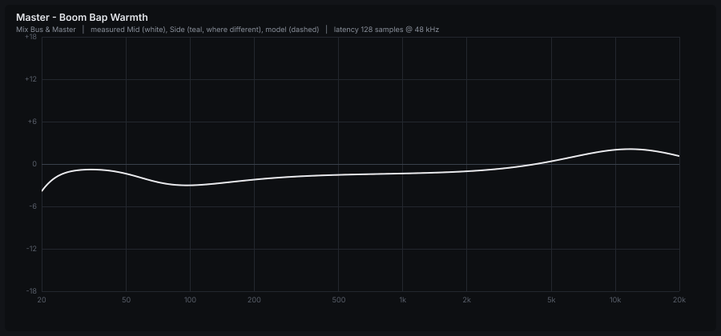

## Master - Air & Clarity

*Mix Bus & Master* - Linear Phase: Air module at 40 kHz (+3 dB, lifts only the top octave), slight presence, low-mid clean-up.

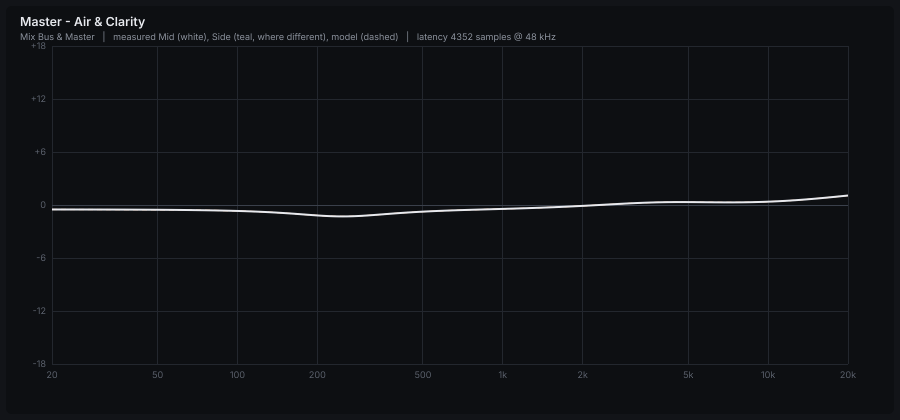

## Master - Low-End Control (dynamic)

*Mix Bus & Master* - Dynamic low end: 60 Hz and 150 Hz bands only reduce boomy notes (max -3 / -2 dB), the rest stays untouched.

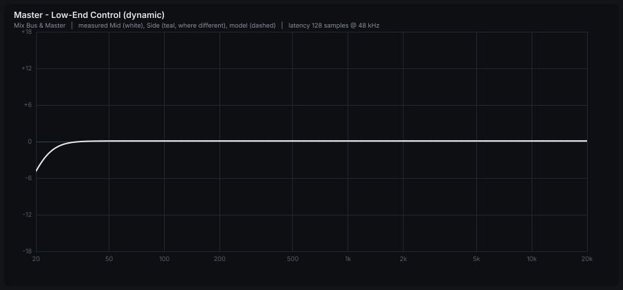

## Master - M/S Widen Highs

*Mix Bus & Master* - Linear Phase M/S: Side air shelf at 8 kHz for width, Side low cut at 120 Hz (keeps the low end centred), tiny Mid low-mid dip.

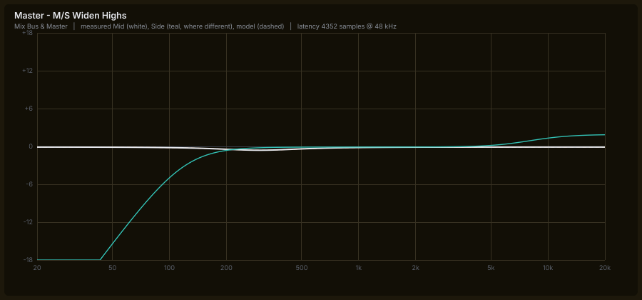

## Master - Mono Bass

*Mix Bus & Master* - Linear Phase: everything below ~120 Hz in mono (steep Side low cut), +0.5 dB Mid low shelf.

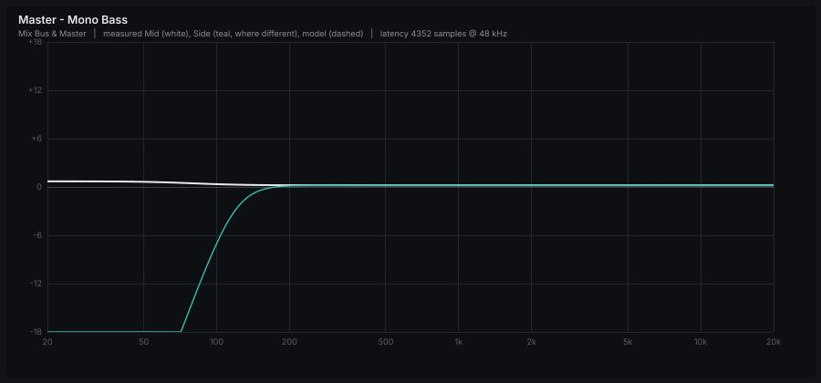

## Master - De-Harsh

*Mix Bus & Master* - Dynamic 3 kHz and 6 kHz bands that soften harsh moments only, plus a very slight tilt down.

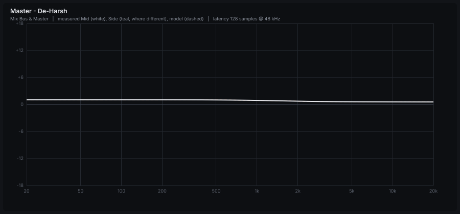

## Master - Loudness Prep

*Mix Bus & Master* - Before a limiter: steep 28 Hz cut (sub energy wastes headroom), mono lows, dynamic 3.5 kHz so limiting doesn't make it harsh, slight 150 Hz clean-up. Linear Phase, High resolution (steep low cut).

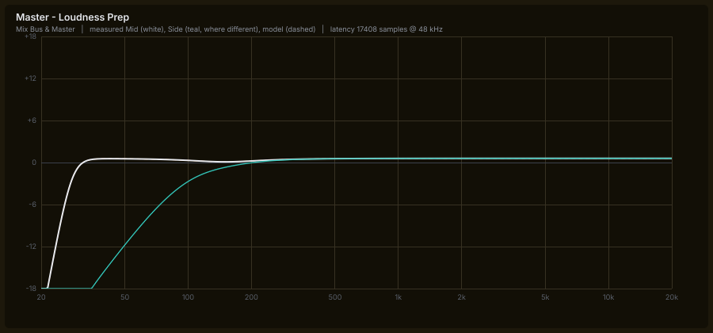

## Mix Bus - Console Glue

*Mix Bus & Master* - Console G on the mix bus: gentle LF and HMF lift with proportional Q and drive for that glued, forward feel.

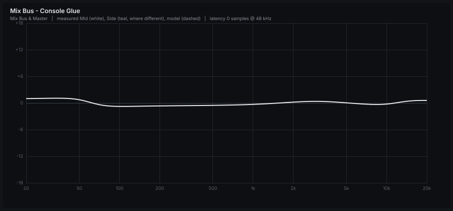

## Mix Bus - Spectral Resonance Control

*Mix Bus & Master* - Spectral dynamics on the mix bus: ringing low-mids (200-500 Hz) and piercing upper mids (1.5-5 kHz) are tamed only where and when they stick out; a touch of air on top. Transparent when nothing rings.

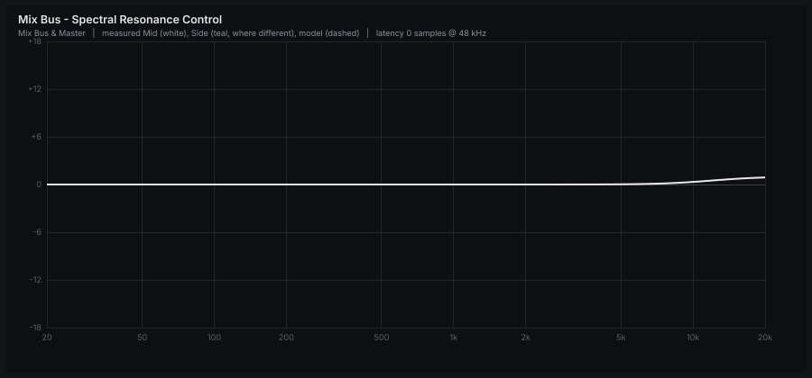

## Axell Signature - LCT 440 Pure

*Axell Signature* - Tuned to Axell's measured voice on the condenser: chest shelf (+3 dB 140 Hz), booth box cut (-4 dB 450 Hz), split presence (2.8 + 4.6 kHz), dynamic sibilance at 8.7 kHz, gentle 40 kHz air.

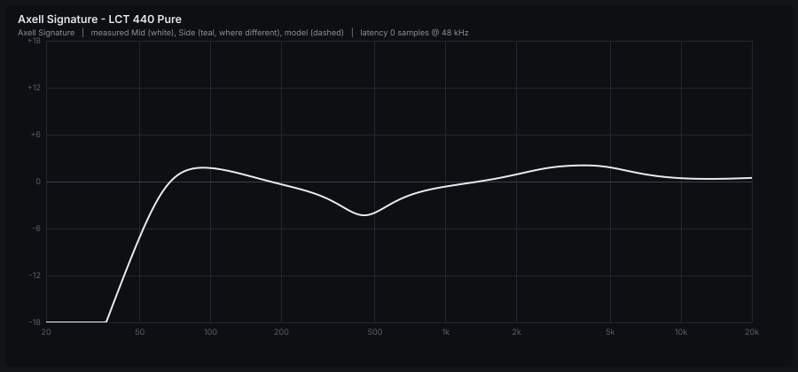

## Axell Signature - SM7B

*Axell Signature* - Tuned to Axell's voice on the dynamic mic: less chest (proximity already adds it), more presence (+2.5 dB at 2.8 and 4.6 kHz), softer de-essing, Air at 20 kHz to open the darker top.

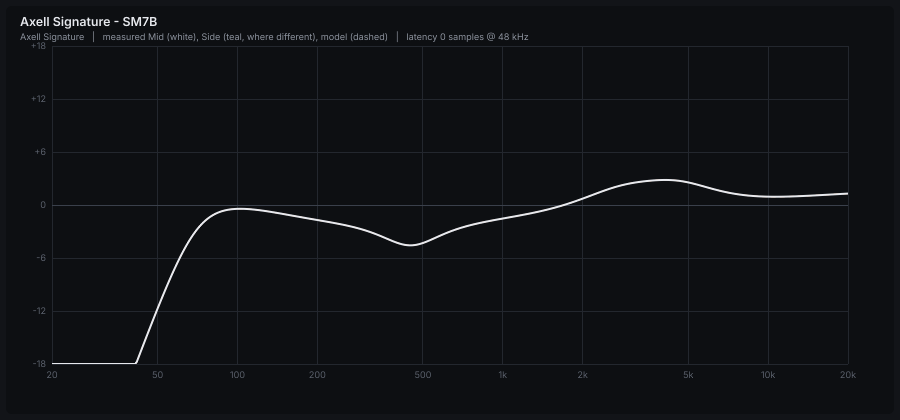

## Axell Signature - Booth Fix

*Axell Signature* - For the foam-lined wardrobe booth with either mic: the 450 Hz box cut is DYNAMIC (only when the room builds up), chest shelf, split presence, dynamic sibilance and air.

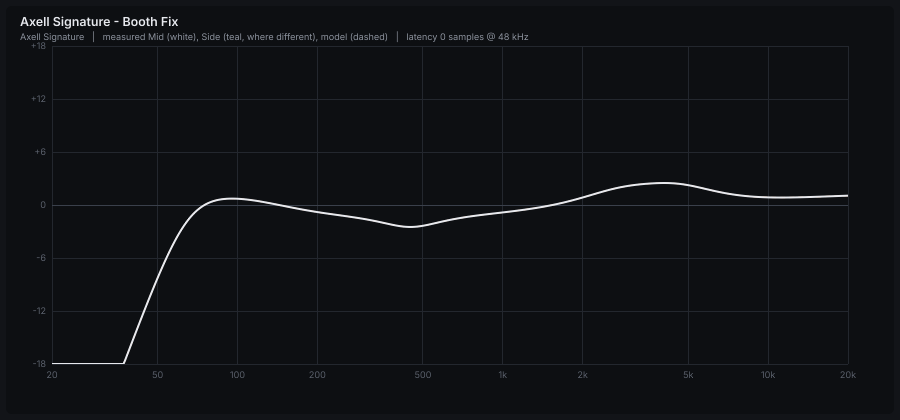

## Axell Signature - Tracking (Light)

*Axell Signature* - Light, zero-latency version of the booth fix for monitoring while recording: chest, static box cut, one presence band, fast de-esser. No character, no latency.

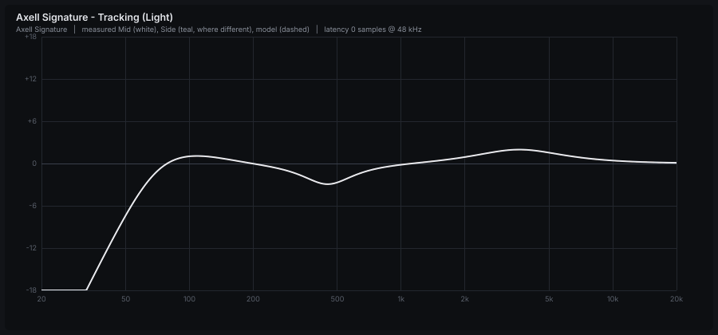

